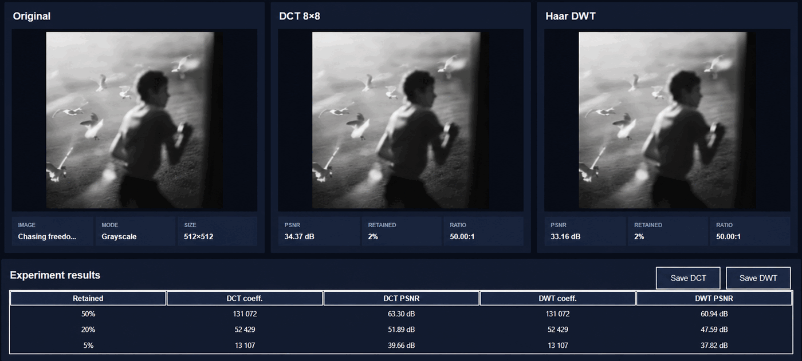

# Лабораторна робота №3 — DCT та DWT

Програма експериментального стиснення зображень із втратами. Вона порівнює власні реалізації блочного DCT `8×8` і багаторівневого дискретного вейвлет-перетворення Хаара.

## Можливості

- завантаження PNG, JPEG, BMP, TIFF або WebP;
- перетворення в grayscale і підготовка зображення `512×512`;
- власне пряме й обернене DCT через матрицю косинусів;
- власне пряме й обернене DWT Хаара;
- стиснення через збереження заданої частки найбільших коефіцієнтів;
- порівняння `Original | DCT | DWT`;
- PSNR, кількість коефіцієнтів та умовний коефіцієнт стиснення;
- експерименти для 50%, 20% і 5% коефіцієнтів;
- збереження відновлених зображень.

Готові функції `dct`, `idct`, `dwt`, `idwt` та wavelet-бібліотеки не використовуються. NumPy застосовується лише для масивів, сортування і матричного множення.

## Структура

```text
multimedia_lab3/
├── algorithms/
│   ├── common.py       # відбір найбільших коефіцієнтів
│   ├── dct.py          # власне DCT та IDCT
│   └── dwt.py          # власне Haar DWT та IDWT
├── tests/
│   └── test_algorithms.py
├── app.py              # Tkinter UI
├── image_utils.py      # підготовка зображень
├── metrics.py          # MSE, PSNR, коефіцієнт стиснення
└── requirements.txt
```

## Запуск у Visual Studio Code

Відкрийте папку `multimedia_lab3` у VS Code та виконайте в терміналі:

```powershell
py -m venv .venv
.venv\Scripts\activate
pip install -r requirements.txt
python app.py
```

Якщо команда `python` недоступна, використайте `py app.py`.

## Перевірка

Алгоритмічні тести:

```powershell
python -m unittest discover -s tests -v
```

Швидкий тест без відкриття інтерфейсу:

```powershell
python app.py --self-test
```

## Принцип стиснення

Для обох методів зберігається заданий відсоток коефіцієнтів із найбільшими абсолютними значеннями. Решта коефіцієнтів обнуляються. Це дозволяє порівнювати DCT і DWT за однакової кількості збережених значень.

Показник `total / retained` є умовним коефіцієнтом стиснення за кількістю коефіцієнтів. Він не дорівнює відношенню розмірів PNG/JPEG-файлів, оскільки в лабораторній роботі не реалізується окремий формат кодування коефіцієнтів.

## Результати експерименту

Нижче наведено результати для одного тестового зображення розміром `512×512`. Для обох методів на кожному рівні зберігалася однакова кількість коефіцієнтів.



> Верхня частина скриншота показує окремий запуск із 2% коефіцієнтів. Серія експериментів для 50%, 20% і 5% наведена в таблиці нижче.

| Збережено | Коефіцієнти DCT | PSNR DCT | Коефіцієнти DWT | PSNR DWT |
|---:|---:|---:|---:|---:|
| 50% | 131 072 | 63.30 dB | 131 072 | 60.94 dB |
| 20% | 52 429 | 51.89 dB | 52 429 | 47.59 dB |
| 5% | 13 107 | 39.66 dB | 13 107 | 37.82 dB |

### Коротке порівняння методів

- зі зменшенням частки збережених коефіцієнтів PSNR обох методів знижується, тобто відновлене зображення сильніше відрізняється від оригіналу;
- на цьому тестовому зображенні DCT має вищий PSNR на всіх трьох рівнях стиснення;
- різниця між DCT і DWT становить 2.36 dB для 50%, 4.30 dB для 20% і 1.84 dB для 5%;
- DCT добре концентрує енергію всередині блоків `8×8`, але при сильному стисненні можуть з’являтися межі блоків;
- DWT аналізує зображення на кількох масштабах і не має фіксованої сітки блоків, однак при відкиданні великої кількості коефіцієнтів також втрачає дрібні деталі;
- результат залежить від конкретного зображення, тому вищий PSNR DCT у цьому експерименті не означає, що він завжди кращий за DWT.
